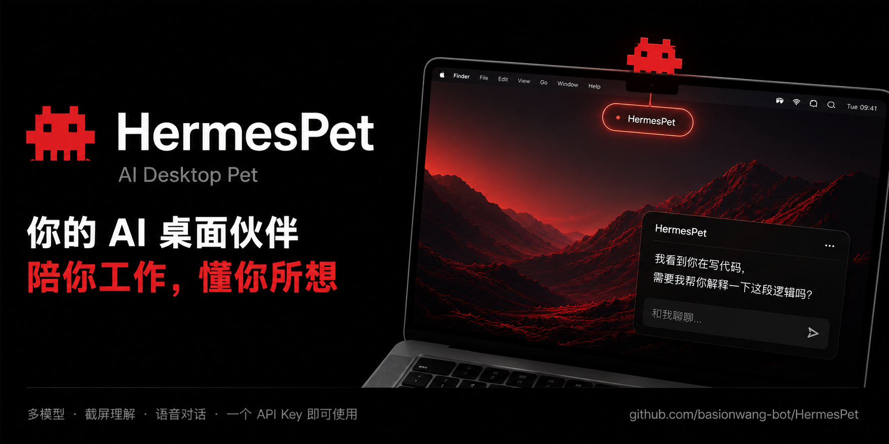

<div align="center">



# Tars

**住在 MacBook 刘海里的原生 AI 客户端与 TARS 机器人**

[](https://www.apple.com/macos/)
[](https://www.swift.org/)
[](LICENSE)

**中文** · [English](./README.en.md)

</div>

Tars 是一个 SwiftUI 原生 macOS 应用。点击刘海下方的胶囊呼出聊天，来自《星际穿越》的 TARS 机器人会在灵动岛、聊天状态条和桌面之间活动。整个应用只有这一个角色，切换 AI 模式不会更换形象。

> Swift 6 · SwiftUI · macOS 14+ · 无 Electron · 无 WebView

## 核心能力

- 最多 8 个独立对话，可并行流式执行
- AI 助手、Claude Code、Codex 三种模式
- OpenAI Agents API（Beta）：云端会话与调度，连接本机执行器
- 内嵌 opencode：支持 DeepSeek、Kimi、智谱、MiniMax、OpenAI 等服务商模型
- Claude Code / Codex CLI 位于高级设置；旧版 Hermes / OpenClaw 选择自动迁移到 opencode
- Markdown、GFM 表格、代码块、图片、文件路径附件和 Codex 生图
- ScreenCaptureKit 截屏、按住说话、全局快问、桌面 Pin
- 灵动岛展示连接状态、工具调用、执行步骤、文件修改和完成状态
- TARS 桌面巡视、文件扫描和桌面图标探索

## 三种模式

| 模式 | 适合场景 | 准备工作 |
|---|---|---|
| **AI 助手** | 对话、写作、看图、本地 agent 工具 | 设置中选择 Agents API 或 opencode，并配置相应密钥 |
| **Claude Code** | 文件修改、命令执行、编程任务 | 本机 Claude 已登录 |
| **Codex** | 编程任务、命令执行、生图 | 本机 Codex 已登录 |

## OpenAI Agents API 接入

在设置 → AI 助手中选择 OpenAI Agents API，填写模型、应用密钥和专用执行环境密钥。密钥存系统钥匙串。应用密钥需要 `api.agents.read`、`api.agents.write`、`api.responses.write`；执行环境密钥只授予环境连接权限，且与应用密钥属于同一项目和账号。详见 [OpenAI 配置说明](https://developers.openai.com/api/docs/guides/agents-api/environments/self-hosted)。

本机需要支持 `codex exec-server` 的 Codex CLI。Tars 按对话启动执行器，使用 Agents API 原生会话、MCP、Skills 和多 Agent 配置；云端自动管理上下文压缩。Agent 能力设置中可选择工作目录、Skills 目录、记忆和 MCP。文档附件发送路径，图片以图像输入发送。

先保存设置并检测连接，再点击「验证一次对话」完成真实联调（调用模型会产生 API 用量）。检测连接只验证应用接口和执行器版本，不能证明模型和环境密钥有效。未配置或未验证时可继续使用 opencode；现有用户的默认引擎不自动切换。

每个对话绑定自己的引擎和会话。流关闭或 idle 事件不视为成功；任务完成需要确认根 Agent 的终态。断流时先查已保存的终态和输出，无法确认则请求取消并停止本机执行器，不重放输入。重启后保留未确认标记；仍不确定时需要清空该对话重建会话。浏览器授权等额外交互尚未接入，此时明确报错并取消。

## 快速开始

需要 macOS 14+ 和完整 Xcode：

```bash
git clone https://github.com/simpledavid/opencrab.git
cd opencrab
./install.sh
```

`install.sh` 会构建并安装到 `/Applications/Tars.app`。

## 快捷键

| 快捷键 | 功能 |
|---|---|
| `⌘⇧H` | 呼出或收回聊天窗 |
| `⌘⇧J` | 截屏并附加到当前对话 |
| `⌘⇧V` | 按住说话，松开发送 |
| `⌘⇧Space` | 快问 |
| `⌘⇧P` | Pin 当前对话最新 AI 回复 |
| `⌘N` | 新对话 |
| `⌘1` ~ `⌘8` | 切换到指定对话 |

## 构建脚本

| 脚本 | 用途 |
|---|---|
| `./build.sh` | 构建项目目录下的 `Tars.app` |
| `./install.sh` | 构建、安装到 `/Applications/Tars.app` 并启动 |
| `./make-dmg.sh` | 生成 Apple Silicon 与 Intel DMG |

## 数据与兼容

为了保留旧版本用户的数据、TCC 权限和本地工具配置，以下内部路径与标识继续沿用：

| 路径或标识 | 用途 |
|---|---|
| `com.nousresearch.hermespet` | 兼容 bundle ID |
| `~/.hermespet/` | 对话、图片、Pin、活动数据和模型配置 |
| `~/Library/Application Support/HermesPet/` | opencode runtime 与会话目录 |
| `~/Library/Caches/HermesPet/` | 临时附件与截图 |

这些旧名属于内部兼容层，用户可见产品名统一为 Tars。

## 隐私

- API 请求只发送到用户选择的服务商或本机 agent
- 活动数据和对话记录默认保存在本机
- 桌面巡视会过滤包含密码、合同、薪资、`.env` 等敏感关键词的文件名
- Tars 不包含独立遥测后端

技术约束与开发约定见 [CLAUDE.md](./CLAUDE.md)。

## License

[Apache License 2.0](./LICENSE)
